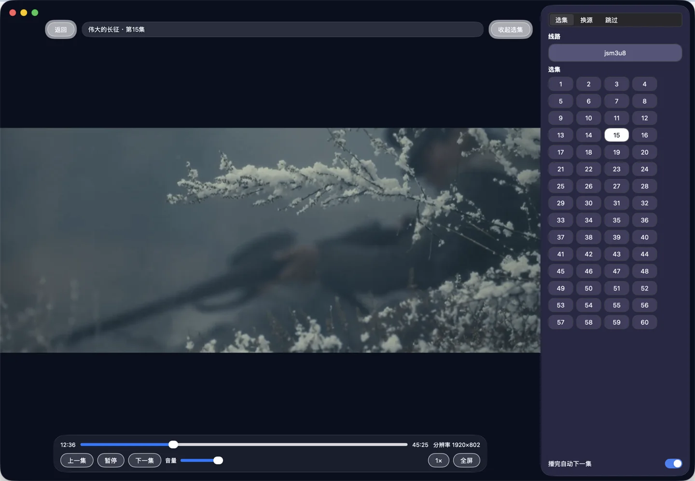
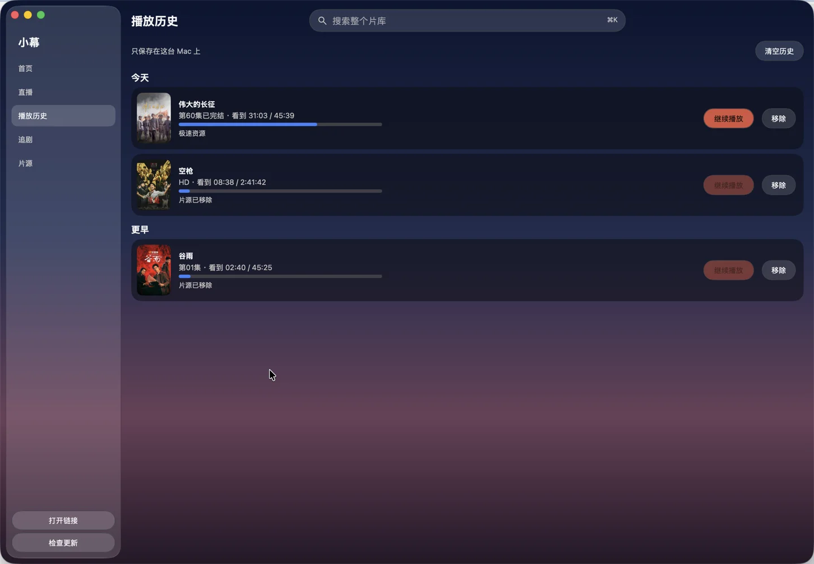

# 小幕 Xiaomu

小幕是一款基于 MyGo 构建的 macOS 原生播放器。导入自己的 TVBox 配置，在 Glass 界面里跨站找片、选集和续播。也支持 IPTV 直播与视频直链。 [MyGo 项目](https://github.com/egoist/mygo)

macOS 13+ · Apple Silicon / Intel · [下载最新版](https://github.com/arixbit/xiaomu-desktop/releases/latest) · [更新记录](CHANGELOG.md)

## 快速上手

- **TVBox 点播**　首次打开时，在「首页」的「配置地址」粘贴自己的配置 URL，点「导入」。按 `⌘K` 输入片名并回车进行跨站搜索，打开影片选集播放。换配置可到「片源 → 添加片源」。
- **IPTV 直播**　首次添加时，进入「直播 → 添加直播源」，导入 M3U/M3U8、TXT 列表或含 `lives` 的 TVBox 配置地址，再选择频道。随点播配置导入的频道也可在「直播」页找到，独立直播源可在「片源」页管理。
- **MP4 / M3U8 直链**　点侧边栏的「打开链接」，粘贴 HTTP 或 HTTPS 视频地址，按需填写 Referer、User-Agent，再点「播放」。

**TVBox 兼容性**　支持 XML / JSON CMS（type 0 / 1）、drpy2、通用 XBPQ 和基础 FongMi JS。Android jar 爬虫与 Python 脚本暂未适配。

## 界面预览

  
  

点击截图查看原尺寸。截图展示了导入配置后的界面，播放内容来自用户自备的片源。

更多界面截图（4 张）

  
  

  
  

## 下载与安装

最新版提供 `.dmg` 和 ZIP 两种 Universal 安装包，支持 macOS 13 及以上。发布附件中提供 `SHA256SUMS` 校验文件。 [GitHub Releases](https://github.com/arixbit/xiaomu-desktop/releases/latest)

1. 打开 DMG 或解压 ZIP，把 `Xiaomu.app` 移到「应用程序」。
2. 安装包目前使用本地签名，尚无 Apple Developer ID 签名及公证。首次打开若被系统拦截，确认下载来源后，到「系统设置 → 隐私与安全性」选择「仍要打开」。也可在确认来源后运行 `xattr -d com.apple.quarantine /Applications/Xiaomu.app`，移除隔离标记并跳过 Gatekeeper 的首次检查。
3. 从 v0.3.0 起，可在侧边栏点「检查更新」升级。更早版本需要先手动安装新版。

## 观看与追剧

- **发现影片**　首页可浏览豆瓣热播和从片库汇集的「最近更新」。点豆瓣海报会在自己的片库中搜索，同名结果集中显示，可展开来源、线路和分集。
- **继续观看**　首页展示最近观看的 6 部影片及进度。续播优先尝试该剧上次实际播出的来源和线路，匹配同一集后恢复进度。缺集或地址解析失败时，若原播放记录的来源仍可用，会回退到该来源重试。播放器打开后若出错，可点「重试」，也可在有备选时换线路或换来源。
- **追剧**　保留原有收藏，显示观看进度、最新分集和新集标记。启动时或点击「刷新追剧」，会检查已导入来源的更新。
- **播放控制**　在播放页「跳过」按剧保存片头和片尾秒数。开启自动下一集且有下一集时，片尾跳过生效。空格暂停或继续，左右方向键快退或快进 10 秒，`Esc` 退出全屏。音量、点播播速和自动下一集设置保存在本机。
- **直播频道**　支持频道搜索、分组和上下切台。直播使用 AVPlayer 可解码的 HTTP 或 HTTPS 流，播放失败时会尝试可用的备用线路。

## 免责声明

小幕只提供播放器。配置、规则和播放内容由使用者自行提供，使用者对自己的使用行为负责。配置地址与播放记录保存在本机。

## 技术与致谢

MyGo 是 Egoist 创建的 Go 桌面应用框架。小幕用它创建 macOS 原生窗口，用 `ui` 包和 Glass 插件构建界面，并通过 `ui.Video` 接入系统播放器 AVPlayer。小幕的应用包也由 MyGo 的构建工具生成。

感谢 Egoist 和 MyGo 项目的贡献者。

## 开发与发布

- Go 环境、命令行探针、脚本依赖与本机播放验证。 [开发文档](docs/development.md)
- Universal 打包、签名更新与发布附件。 [发布维护说明](docs/releasing.md)

## 许可证

Copyright (c) 2026 arixbit。除另有声明的第三方材料外，小幕采用 [CC BY-NC-SA 4.0（署名—非商业性使用—相同方式共享）](LICENSE)。

分享时须保留作者署名、[本项目地址](https://github.com/arixbit/xiaomu-desktop)及许可证信息，并标明所作修改；仅限非商业性使用，改编后分享须遵循相同许可证。完整条款见 [LICENSE](LICENSE) 和 [官方许可文本](https://creativecommons.org/licenses/by-nc-sa/4.0/legalcode.zh-hans)。

第三方依赖与单独标明许可证的材料继续遵循各自许可证。本次变更不撤销此前已按 MIT 许可证授予的权利。
