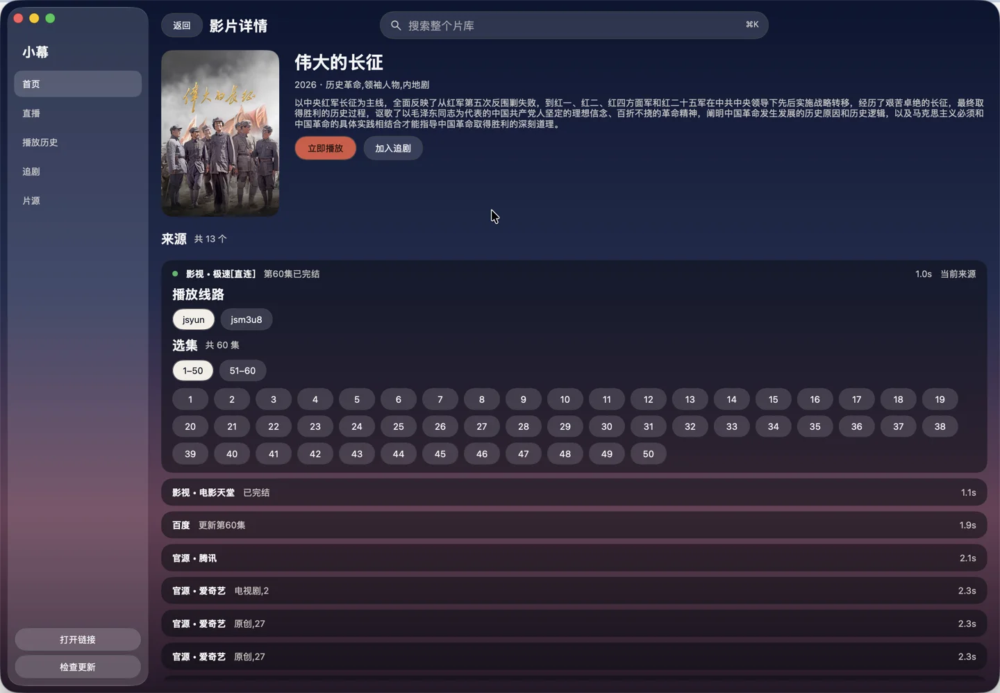
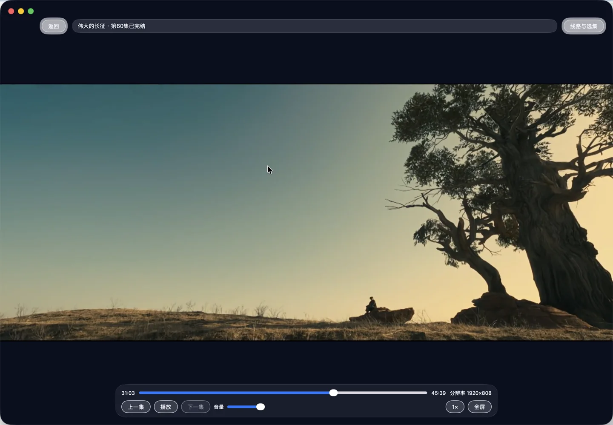

# 小幕 Xiaomu

[](https://awesomemygo.dev/apps/xiaomu-desktop)

一款基于 MyGo 构建的原生多源播放器。导入自己的 TVBox 配置、IPTV 列表，或直接打开视频链接。 [MyGo 项目](https://github.com/egoist/mygo)

macOS 13+ · Apple Silicon / Intel · Windows 10/11 · x64 / ARM64 · [下载最新版](https://github.com/arixbit/xiaomu-desktop/releases/latest)

- **跨站搜索**　按 `⌘K` 输入片名，同名影片的多个来源集中显示。
- **选集播放**　在详情页选线路和分集，播放中也能切换来源。
- **继续观看**　回到首页，从上次的分集和进度接着看，也能查看追剧更新。

**快速上手**　在首页粘贴自己的配置地址并导入 → 搜索片名 → 打开影片选集播放。

## 界面预览

<p>
  <a href="docs/screenshots/home.webp?raw=true"></a>
  <a href="docs/screenshots/player.webp?raw=true"></a>
</p>

点击截图查看原尺寸。截图展示了导入配置后的界面，播放内容来自用户自备的片源。

<details>
<summary>更多界面截图（4 张）</summary>

<p>
  <a href="docs/screenshots/search.webp?raw=true"></a>
  <a href="docs/screenshots/detail.webp?raw=true"></a>
</p>
<p>
  <a href="docs/screenshots/player-wide.webp?raw=true"></a>
  <a href="docs/screenshots/history.webp?raw=true"></a>
</p>

</details>

## 下载与安装

v0.8.6 在侧边栏左下角增加新版提示，后台发现新版后显示“有新版本”和提示圆点。macOS 提供通用 DMG 和 ZIP，Windows 提供 x64 和 ARM64 安装包。下载页附有 `SHA256SUMS` 校验文件。[最新版下载](https://github.com/arixbit/xiaomu-desktop/releases/latest) · [v0.8.6 版本说明](docs/releases/v0.8.6.md)

### macOS

1. 打开 `.dmg`，将 `Xiaomu.app` 拖到“应用程序”。也可使用 ZIP，解压后移动 App。
2. 本版使用本地签名，尚无 Developer ID 签名及 Apple 公证。首次打开如被系统拦截，请在确认下载来源后，到“系统设置 → 隐私与安全性”选择“仍要打开”。也可以在终端执行 `xattr -d com.apple.quarantine /Applications/Xiaomu.app` 去掉隔离标记，之后双击即可打开；这会跳过 Gatekeeper 的首次检查，只在你信任下载来源时使用。

### Windows

在 GitHub Releases 下载 `xiaomu-setup-0.8.6-amd64.exe`，ARM64 设备使用 `xiaomu-setup-0.8.6-arm64.exe`。按提示安装到当前用户目录，无需管理员权限。安装包未做 Authenticode 签名，首次打开时 SmartScreen 可能提示未知发布者。

打开小幕，在首页导入自己的配置。之后可以在侧边栏“片源”页更换配置，或在“直播”页导入自己的频道列表。

## 免责声明

小幕只是播放器。它不提供、不收录、不分发任何影视内容。配置和规则由使用者自己提供，使用后果也由使用者自己承担。

## 功能

v0.8.6 更新：后台检测到新版时，侧边栏左下角持续显示“有新版本”和提示圆点，点击可查看更新说明并安装。

v0.8.3 优化：取消搜索及时停止脚本计算；限制后台任务和海报的总资源占用；合并搜索结果更新，减少万条结果时的界面停顿；切换配置时停止旧测速。原生界面、正常海报画质及完整搜索功能保持。

v0.8.2 修复：播放期间保持显示器和电脑唤醒，暂停或结束后恢复正常睡眠；播放页顶部空白处和视频黑边可拖动窗口；单击画面暂停／继续，双击进入／退出全屏且不改变播放状态。

v0.8.1 修复：部分 HLS 视频停在结尾前不足一秒时无法自动播放下一集，以及切集时读取旧播放器可能导致的崩溃。暂停、缓冲、关闭自动播放或最后一集时不会误切。

v0.8.0 更新：

- **系统通知**：追剧发现新集时提醒，点击进入详情；首次需要通知时才请求授权。
- **本地视频与链接**：支持从 Finder 用小幕打开 mp4、mov、m4v、m3u8，以及通过 xiaomu:// 链接播放或搜索。文件默认打开方式由 macOS 设置决定。
- **系统正在播放**：控制中心显示片名、分集和播放状态，媒体键支持播放／暂停及切换分集或频道。
- **播放衔接修复**：外部播放保留原剧进度并取消旧解析任务；冷启动搜索和通知等待配置恢复；同步系统分集、倍速、进度与结束状态。
- **详情与测速**：显示已知豆瓣评分，片源页可测速，播放页显示代理下载速度。

观看与追剧：

- **继续观看**：首页最上方显示最近 6 部的海报、分集和进度，点击直接续播。“从这里移除”仅隐藏首页入口，保留播放历史；再次播放后恢复。
- **追剧**：原收藏自动保留，显示观看进度、最新分集和新集标记；启动或点击“刷新追剧”检查用户已导入的来源，可直接继续观看或看下一集。更新失败保留上次结果，移除配置不会删除追剧。
- **本剧跳过**：播放页的“跳过”页签可设置片头、片尾秒数，按剧保存在本机，后续分集沿用，也可随时关闭。片尾在开启自动下一集且存在下一集时生效。
- **来源记忆**：同剧优先上次实际播放成功的来源和线路，并记录起播等待与播放失败。解析成功不算实播成功；续播严格匹配同一集，播放中仍由用户手动换源。
- **点播恢复**：解析失败，或连续 30 秒没有画面／缓冲没有进度时，提供重试、换线路及可用的换来源入口。超时会暂停当前视频，手动选择后重新解析；保留对应分集与续播位置。
- **播放偏好**：音量、点播播速、自动下一集开关保存在本机，重启与切集后恢复。直播使用正常速度。
- **弹幕**：点击播放页“弹幕”即可开启，片源未提供弹幕时自动使用[开源项目的公共弹幕服务](docs/danmaku.md)，无需填写地址或密钥。切集和换源时跟随当前分集重新匹配；也可直接修改片名和集数搜索并手动选择，集数留空可查看全部分集。支持滚动、顶部、底部弹幕，以及字号和不透明度调整；暂停、拖动进度和倍速播放时同步，全屏隐藏控件后继续显示。默认关闭，开启后公共服务会收到搜索片名与集数。“服务设置（可选）”可改用自己的弹弹play兼容服务；偏好仅保存在本机。
- **播放防睡眠**：视频播放期间阻止系统因闲置而熄屏或睡眠；暂停、结束、播放失败或离开播放器后恢复正常睡眠，不修改系统电源设置。

现有功能：

- 配置加载：仓库（`urls` 线路列表）或单份配置；带注释和尾逗号的 JSON；JPEG/PNG 里的 `前缀**base64`；HTTP 失败时改走 HTTPS；把 `api`、`ext`、`spider` 的相对路径解析成绝对地址。jar 只解析，不下载、不执行。
- 站点分类：type 0 XML CMS、type 1 JSON CMS、type 3 的 drpy2（`.js`）与 FongMi class、`csp_XBPQ` 文本规则（原生解释）、其他 `csp_` jar（未适配）、`.py`（不支持）。
- drpy2 宿主：QuickJS（`modernc.org/quickjs`，无 cgo）。按 ES 模块加载引擎和 `ext` 规则，并能加载 `assets://js/lib/` 下的 cheerio、crypto-js、jsencrypt、gbk、模板.js。宿主提供 `req`、`joinUrl`、`local.get/set/delete`，以及用 Go 实现的 `pdfh` / `pdfa` / `pd`。
- `xiaomu-probe`：给定配置地址和可选线路名，对前 N 个站点跑 首页 → 分类 → 详情 → 播放，打印通过/失败和耗时。
- 原生片库窗口：导入后自动汇集仓库内各条线路的首页推荐与最近更新；在顶部搜索框输入片名即可跨站搜索，结果陆续显示，同名影片合并为一项并标出来源数；点击海报进入详情页，选择来源和分集播放。搜索优先展示片名精确匹配，支持加载更多结果。单站分类浏览在“片源”页。已导入的配置地址和本地脚本目录只保存在本机，重启后恢复。支持 drpy2、type 0/1 CMS、基础 FongMi class 和通用 XBPQ；专用 Android jar 自动跳过。后台请求限制并发、逐站超时，并可停止。
- 豆瓣热播：首页提供“热播电影／热播剧集／最近更新”。豆瓣提供片名、海报、评分和更新集数，点击海报即在用户导入的片库中搜索；榜单不提供播放地址。两类榜单分别缓存在本机，6 小时内复用，也可手动刷新；更新失败时保留上次的列表。海报请求会携带豆瓣所需的 Referer 和 User-Agent。
- 打开链接：侧边栏底部“打开链接”可粘贴 mp4/m3u8，可选 Referer 和 User-Agent。片库解析出的请求头也会经本机 `127.0.0.1` 代理注入，再交给 MyGo `ui.Video` 播放。
- 网页取流：识别 CMS 分享页、HTML5 播放器、MacCMS 播放配置与 iframe，支持配置中的 type 0 网页解析和 type 1 JSON 解析。动态网页使用临时 WKWebView 会话，采集媒体请求和所需 UA / Referer / Cookie，不向页面开放 Go 方法。
- 独立播放页：MyGo 原生视频画面、Glass 控件、进度、播放速度、音量、全屏、线路与选集，以及可关闭的播完自动下一集。进度条右侧显示当前解码画面的实际分辨率，全屏时随播放控件隐藏和恢复。
  打开“换源与选集”可查看当前来源、线路和分集。有多个已知来源时，点来源名称即可切换。新来源有同一集时会接着原进度播放，找不到对应集时可以手动选择。
  播放快捷键：空格暂停／继续，左右方向键快退／快进 10 秒，Esc 退出全屏。全屏控件隐藏时同样有效；输入框、弹窗及正在用键盘操作的控件优先处理按键，直播和时长未知的视频不快进。
  鼠标操作：单击视频画面暂停／继续，双击进入／退出全屏，双击不会改变播放状态；窗口模式下可从播放页空白处、视频黑边或顶部片名栏拖动窗口。
- 系统集成：双击本地 mp4、mov、m4v、m3u8 文件用小幕打开播放；`xiaomu://play?url=...` 打开播放地址，`xiaomu://search?wd=...` 打开应用并搜索片名；追剧发现新集时发系统通知，点击打开该剧详情；播放时系统“正在播放”显示片名和分集，媒体键可播放／暂停、切上一集／下一集（直播切频道）。
- IPTV 直播：M3U/M3U8 频道列表、TXT 分组列表、TVBox `lives` 内嵌频道或外部列表；支持频道搜索、分组、上一/下一频道和备用线路自动切换。列表和频道中的 User-Agent、Referer、Cookie 等请求头经本地代理传递；HLS 分片不会被当成频道。

上游 drpy2 引擎在运行时从你的配置地址加载。`assets://js/lib/` 依赖优先读取 `-assets` 指定的本地文件，否则从所选引擎所在目录加载同名依赖；加载失败会明确报错。仓库里的小型占位模块仅由离线测试显式使用，不再嵌入应用或作为运行时后备。上游库（drpy2 为 LGPL-3.0，cheerio、crypto-js、jsencrypt 等另有各自许可证）不随本仓库分发。

FongMi class 目前覆盖基础文本/JSON 请求与常见分类、详情、播放方法。依赖 Android 宿主、二进制响应或额外加密函数的脚本会显示缺失能力；这些站点仍需单独适配。

## 技术与致谢

MyGo 是 Egoist 创建的 Go 桌面应用框架。小幕用它创建 macOS 原生窗口，用 `ui` 包和 Glass 插件构建界面，并通过 `ui.Video` 接入系统播放器 AVPlayer。小幕的应用包也由 MyGo 的构建工具生成。

感谢 Egoist 和 MyGo 项目的贡献者。

## 环境

- Go 1.27.3 或更新。`go.mod` 的 `go 1.27.3` 即工具链要求；Go 1.27 的 `go mod tidy` 会去掉与这一行相同的 `toolchain` 指令。
- 播放窗口：macOS 13 及以上。MyGo 钉在 `v0.8.4-0.20261111083354-3f52033d99bb`（`video.OpenURL` / AVPlayer 在 v0.8.3 发布之后进入主线）。界面只用包 `ui`，没有网页前端。
- 探针在 Linux 和 macOS 上都能编译运行。

## 探针

```sh
go run ./cmd/xiaomu-probe -config '你的配置地址' -line '线路名' -n 3
```

`-line` 可省略，省略时用仓库的第一条。引擎目录缺少依赖或无法访问时，可用 `-assets` 指向 cheerio 等真实库的本地目录（路径形如 `js/lib/cheerio.min.js`，也支持直接放在该目录下）。不要把配置地址写进仓库。引擎自己的 `console.log` 会打在表格前面。

搜索型站点可加 `-query '片名'`，探针会测试搜索列表，不再用首个分类判断。探针只验证站点能否解析出 HTTP 播放地址；是否真能播出，还要在窗口里由 MyGo 播放器确认。

远程 `import` 被拦截或失效时，可以在 `-assets` 目录下放 `modules.json`，把完整模块 URL 映射到该目录内的本地 JS 文件。例如：

```json
{
  "https://example.com/lib/helper.js": "js/lib/helper.js"
}
```

映射只匹配完整 URL，优先读取本地文件；未映射的模块照常联网。文件内的相对导入仍按原始 URL 解析。映射文件和第三方脚本保留在仓库外，不随项目提交。HTTP 失败或返回 HTML 等非脚本内容时，报错会包含失败模块的 URL、状态码和 Content-Type。配置、脚本、海报和播放代理使用 MyGo 的 `netproxy.Transport()`：有代理环境变量时优先使用环境变量，否则读取系统代理设置（macOS 上包括 PAC）。

## 播放窗口

在 macOS 上：

```sh
go tool mygo dev
```

打包：

```sh
go tool mygo build -platform darwin/universal
```

对外发布使用 `sh scripts/build-release.sh`，它要求签名密钥并生成在线更新所需文件。密钥保管、发布步骤和更新附件见 [发布维护说明](docs/releasing.md)。开发模式不会自动检查更新。

正式版默认在后台检查更新。发现新版后，侧边栏左下角会显示“有新版本”和提示圆点，悬停可查看版本号，点击进入更新窗口。选择“稍后提醒”后提示保留，选择“跳过此版本”后隐藏该版本的提示。

App 图标素材在 `xiaomu-icon/`。macOS 正式包使用其中的 `macos/AppIcon.icns`；开发运行使用 `resources/icon.png`，与图标集中已留边的 1024px 默认浅色版保持一致。深色及 Icon Composer 素材仅作设计源文件保留，当前不会随系统外观自动切换图标。

窗口默认打开首页。左侧侧边栏有“首页”“直播”“播放历史”“追剧”“片源”五页，“返回”逐级回到上一页。首次启动时还没有片源，首页显示“添加片源，开始观看”：

1. 在“配置地址”粘贴自己的配置 URL，点击“导入”。以后可在“片源”页点“添加片源”更换配置。首页默认显示豆瓣热播电影，可切换热播剧集；“最近更新”会自动汇集仓库内各条线路的推荐，没有推荐的站点会尝试读取分类的最近更新。
2. 如果脚本需要本地依赖，在“片源”→“添加片源”的“脚本目录（可选）”填写与探针 `-assets` 相同的目录；该目录的 `modules.json` 也会生效。地址与目录只保存在本机用户数据目录，不进入仓库。
3. 点击豆瓣影片海报即可全库搜索，也可在顶部搜索框输入片名后按回车，无需先选线路、站点或分类。同名影片合并显示，点击进入详情页，选择来源和分集播放。播放页会提取媒体地址，动态网页交由隔离的 WKWebView 嗅探；取流失败时在播放页显示原因，可换下一条线路、换来源或重试。
4. 看过的点播记在“播放历史”，点“继续播放”从上次的分集和进度接着看。历史只记站点、分集和进度，不保存媒体地址，存在本机用户数据目录；对应片源移除后，该条标为“片源已移除”。

加载成功后，下次打开会恢复已导入的配置。失效站点不会阻塞其他结果；不兼容或声明不参与搜索的站点会跳过。搜索可停止并保留已返回结果，也可重新加载。“片源”页可刷新或移除配置，展开线路可单站分类浏览。想测试视频直链，点侧边栏底部“打开链接”，填写 http(s) mp4/m3u8 地址和可选的 Referer、User-Agent，再点“播放”。HEVC 能否播出取决于这台 Mac 的系统解码器。

CMS 全库搜索和影片详情直接请求对应接口，不依赖分类接口是否可用。搜索结果按来源、关键词和页码在内存中缓存 10 分钟；请求失败的站点冷却 30 秒，之后再次搜索会重试，已有的有效缓存仍可展示。缓存有容量上限，不写入磁盘；更换片库或点击“重新加载”会清除搜索缓存和冷却状态，立即重新请求。主动停止搜索不会将站点标记为失效。

看 IPTV 时，点击左侧“直播”→“添加直播源”，导入自己的 M3U、TXT 或含 `lives` 的 TVBox 配置地址。选择来源、分组和频道即可播放；播放页可切频道及备用线路。单独导入的直播地址会保存，不替换已导入的点播配置。“添加片源”也能直接识别直播列表；TVBox 配置自带的直播在“直播”页选择。

当前直播播放支持 AVPlayer 能解码的 HTTP/HTTPS 视频流。已用用户提供列表中的多个 HLS 频道验证原生连续画面；可用性仍受来源、网络与编码影响。UDP/RTP 组播需由用户的 udpxy 等服务转换为 HTTP；RTSP/RTMP、节目单和回看尚未实现。HTTP-FLV 暂未转换为 AVPlayer 可读格式。失败或 15 秒未启动的频道会自动尝试备用线路，每条只试一次。

## 测试

```sh
go test ./...
go vet ./...
```

测试只用本地夹具，不访问网络，也不包含真实片源地址。

macOS 上可额外验证真实 AVPlayer 解码。用已安装的 FFmpeg 在仓库外生成测试流，再运行选择性测试（会启动 macOS 事件循环，静音播放）：

```sh
mkdir -p /tmp/xiaomu-local-hls
ffmpeg -f lavfi -i testsrc2=size=160x90:rate=10 -f lavfi -i sine=frequency=440:sample_rate=48000 -t 6 -c:v libx264 -pix_fmt yuv420p -g 10 -c:a aac -hls_time 1 -hls_list_size 0 -hls_flags independent_segments -hls_segment_filename /tmp/xiaomu-local-hls/segment-%03d.ts /tmp/xiaomu-local-hls/stream.m3u8
XIAOMU_NATIVE_MEDIA_DIR=/tmp/xiaomu-local-hls go test ./cmd/xiaomu -run '^TestNativeIPTVHLS$' -v -count=1 -timeout=45s
XIAOMU_NATIVE_MEDIA_DIR=/tmp/xiaomu-local-hls go test ./cmd/xiaomu -run '^TestNativeAutoNextAtHLSEnd$' -v -count=1 -timeout=30s
XIAOMU_NATIVE_MEDIA_DIR=/tmp/xiaomu-local-hls go test ./cmd/xiaomu -run '^TestNativePlaybackPowerAssertions$' -v -count=1 -timeout=30s
```

该测试验证 IPTV 导入、请求头转发、HLS 分片获取、真实解码画面变化及播放时间推进。普通 `go test ./...` 会跳过这项需要本机媒体环境的检查。外部直播地址的可达性、音频实际听感和其他编码仍需单独验证。

自动切集测试使用同一份本地 HLS 夹具，将末段声明时长增加 0.1 秒，复现视频停止但未报告结束的情况，并验证下一集实际开始播放。

防睡眠测试通过 `pmset -g assertions` 核对本进程在播放期间持有显示器和系统闲置睡眠断言，暂停、结束和关闭后释放；不修改系统睡眠计时，也不执行真实睡眠。

## 在 Mac 上确认播放

Linux 上可以编译播放器，但不能跑 AVPlayer。请在 Mac 上：

1. 安装 Go 1.27.3+，克隆本分支。
2. `go test ./...`，确认探针和界面测试通过。
3. `go tool mygo dev` 打开窗口。
4. 点侧边栏底部“打开链接”，粘贴一条你自己的 mp4 直链（可先不填请求头），点播放，确认有画面和声音。
5. 再试一条需要 Referer 或 User-Agent 的 m3u8，填上后播放。代理会改写播放列表，分片也走同一组请求头。
6. 若有 HEVC 片源，用同样步骤看系统是否能解。
7. `go run ./cmd/xiaomu-probe -config '你的配置地址' -n 1`，看 drpy2 站点是否出现 PASS。
8. 回到“首页”，用同一份配置验证自动推荐、全库搜索、详情页来源、分集及播放；在“片源”页展开线路验证单站分类浏览。

## 许可证

Copyright (c) 2026 arixbit。除另有声明的第三方材料外，小幕采用 [CC BY-NC-SA 4.0（署名—非商业性使用—相同方式共享）](LICENSE)。

分享时须保留作者署名、[本项目地址](https://github.com/arixbit/xiaomu-desktop)及许可证信息，并标明所作修改；仅限非商业性使用，改编后分享须遵循相同许可证。完整条款见 [LICENSE](LICENSE) 和 [官方许可文本](https://creativecommons.org/licenses/by-nc-sa/4.0/legalcode.zh-hans)。

第三方依赖与单独标明许可证的材料继续遵循各自许可证。本次变更不撤销此前已按 MIT 许可证授予的权利。

## Star History

<a href="https://star-history.com/#arixbit/xiaomu-desktop&Date">
  <picture>
    <source media="(prefers-color-scheme: dark)" srcset="https://api.star-history.com/svg?repos=arixbit/xiaomu-desktop&amp;type=Date&amp;theme=dark">
    <source media="(prefers-color-scheme: light)" srcset="https://api.star-history.com/svg?repos=arixbit/xiaomu-desktop&amp;type=Date">
    
  </picture>
</a>
